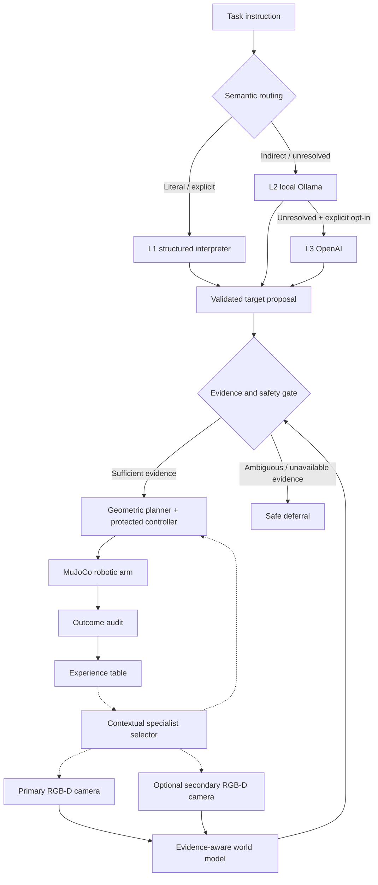

<div align="center">

# RoboEvoSwarm

### Evidence-grounded hierarchical intelligence for adaptive robotic manipulation

**One embodied robot · Heterogeneous specialist agents · L1 → L2 → L3 reasoning · Experience-guided coordination**

    

*Reproducible robotics experiments connecting natural-language task interpretation, RGB-D perception, evidence-based safety, and selectable specialist coordination.*

</div>


> [!IMPORTANT]
> **Research scope:** This repository contains one simulated tabletop robot controlled by multiple **software specialist agents**. It is not a multi-robot fleet or a general-purpose vision-language robotic policy. The local LLM and optional frontier model resolve bounded semantic decisions; **neither issues joint-level motor commands**.

**[Quick start](#quick-start) · [Visual demonstrations](#visual-demonstrations) · [Architecture](#system-architecture) · [Run experiments](#run-the-evaluations) · [Research findings](#reported-research-results) · [Full guide](docs/EXPERIMENT_GUIDE.md)**

---

## What is RoboEvoSwarm?

RoboEvoSwarm is a research prototype for **selecting and coordinating heterogeneous capabilities** during robotic manipulation. A simulated 3-DOF arm acts in a MuJoCo tabletop environment containing coloured objects and a placement target. The system combines traditional geometry and vision with a **task-conditioned reasoning cascade**, an evidence gate, and an experience-based selector that chooses among predefined *lean* and *redundant* specialist compositions.

| Layer | Role | What it actually does |
|:--|:--|:--|
| **L1 — conventional intelligence** | Low-cost, deterministic skills | Structured commands, RGB-D colour segmentation, scene verification, motion planning, controller and outcome audit |
| **L2 — local language model** | Bounded semantic interpretation | Ollama model (e.g. `qwen2.5:7b`) interprets indirect descriptions when required |
| **L3 — optional frontier model** | Explicitly permitted escalation | OpenAI Responses API for unresolved semantic decisions; **off unless enabled** |
| **Evidence-aware world model** | Protect physical action | Observation provenance/freshness, target identity and sufficiency checks; may defer instead of grasping |
| **Coordination selector** | Allocate specialist capabilities | Fixed, event-triggered rule, random, untrained or experience-guided selection of existing specialist groups |

### System architecture



The diagram shows **logical responsibilities**, not physical connections between multiple robots. Dashed arrows denote configurable specialist selection and outcome feedback. The selector chooses among existing capability compositions; it **does not create new agents, skills or graph topologies**.

## Visual demonstrations

The following are **real images saved during the project's MuJoCo experiments**, included with the repository. They are not AI-generated representations of the laboratory.

<table>
<tr>
<td width="50%" align="center"><br><strong>1 · Initial observation</strong><br><sub>Camera-derived RGB view of coloured target candidates.</sub></td>
<td width="50%" align="center"><br><strong>2 · Updated scene</strong><br><sub>Target movement makes the earlier pose estimate stale.</sub></td>
</tr>
<tr>
<td width="50%" align="center"><br><strong>3 · Alternative viewpoint</strong><br><sub>Available for the redundant sensing configuration.</sub></td>
<td width="50%" align="center"><br><strong>4 · Completed manipulation</strong><br><sub>Simulated pick-and-place after a semantic task decision.</sub></td>
</tr>
</table>

<details>
<summary><strong>View the complete four-panel laboratory montage</strong></summary>


</details>

### Object colours and relocation cases


*Recorded scene variations used for qualitative illustration; the experiment runner generates the evaluation scenes from explicit seeds.*

### Task and disturbance gallery

| Environment condition | Example request | Intended response |
|:--|:--|:--|
| **Object relocation** | “Move the blue block to the green target.” | Reobserve, replan and execute |
| **Indirect description** | “Move the ripe-banana-coloured block.” | Resolve yellow with L2 when L1 cannot |
| **Primary depth outage** | Same physical task, camera A loses depth | Recover using an admissible alternative camera if available |
| **Dual depth outage** | Both depth cameras lack valid evidence | **Defer**; do not attempt a blind grasp |
| **Ambiguous request** | “Move the correct block.” | Abstain when no unique target is supported |
| **Shifted scene** | New held-out object arrangement | Evaluate robustness under a nearby changed distribution |

## Quick start

**Requirements:** Windows 11 or a compatible development system, **Python 3.11**, MuJoCo's supported native libraries and a working OpenGL environment for the graphical viewer. Ollama and OpenAI are **optional** for physics-only experiments.

From PowerShell in the repository root:

```powershell
# 1. Create one virtual environment (no Docker required)
py -3.11 -m venv .venv

# 2. Install dependencies
.\.venv\Scripts\python.exe -m pip install --upgrade pip
.\.venv\Scripts\python.exe -m pip install -r requirements.txt

# 3. Create a private model configuration
Copy-Item .env.example .env
notepad .env

# 4. Check the simulator and run the tests
.\.venv\Scripts\python.exe -c "import mujoco; print('MuJoCo:', mujoco.__version__)"
.\.venv\Scripts\python.exe robo_demo.py check
```

> [!NOTE]
> No API key is needed for conventional robot experiments. Never commit `.env`. A university-managed Windows application-control policy can prevent a MuJoCo native extension from loading; if that happens, use an approved Python installation or ask IT rather than disabling institutional controls.

### One-command visual demonstration

```powershell
.\.venv\Scripts\python.exe robo_demo.py demo --scenario moved --split test --scene-seed 50000 --scene-family standard --color blue --mode rule_fixed --disturbance depth_dropout --hold-seconds -1
```

The graphical viewer is held open at the end. Close the MuJoCo window to exit. For automation, replace the hold option with `--headless --hold-seconds 0`.

### Optional: activate local Ollama

Install Ollama separately if needed, then run:

```powershell
ollama pull qwen2.5:7b
ollama list
Invoke-RestMethod http://127.0.0.1:11434/api/tags
```

In your **local** `.env` file, configure:

```dotenv
OLLAMA_BASE_URL=http://127.0.0.1:11434
OLLAMA_MODEL=qwen2.5:7b
# Leave blank unless OpenAI calls are explicitly required:
OPENAI_API_KEY=
OPENAI_MODEL=gpt-4.1-mini
```

Test real local semantics:

```powershell
.\.venv\Scripts\python.exe robo_demo.py reason --instruction "Move the ripe-banana-coloured block to the green target" --llm-mode local
```

To test L3, provide your key in `.env` and use `--llm-mode frontier --allow-openai`. **Frontier calls are billable.** The agent uses bounded structured responses, not natural-language actuator commands.

## Run the evaluations

All entry points are wrapped by **`robo_demo.py`**. Underlying scripts are preserved for exact protocol reproduction.

| Goal | Command |
|:--|:--|
| Run the complete test suite | `python robo_demo.py check` |
| Visualise a robot scene | `python robo_demo.py demo --help` |
| Test semantic routing | `python robo_demo.py semantic-benchmark --strategy hierarchy --provider live` |
| Integrated L1/L2/hybrid baseline | `python robo_demo.py integrated --help` |
| Confirmatory five-policy comparison | `python robo_demo.py study --repeats 5 --train 20 --test 8 --output results/final_study` |
| Multi-seed trained/untrained ablation | `python robo_demo.py multiseed --help` |
| Export robot-study figures | `python robo_demo.py figures --help` |
| Inspect bundled example | `python robo_demo.py example-results` |

Replace `python` with `.\.venv\Scripts\python.exe` if the virtual environment has not been activated.

**Recommended first research run** — quick, low-cost study:

```powershell
.\.venv\Scripts\python.exe robo_demo.py study --repeats 1 --train 2 --test 1 --output results/smoke_study
```

**Complete confirmatory protocol** — five coordination policies, independent training repeats, matched held-out cases:

```powershell
.\.venv\Scripts\python.exe robo_demo.py study --repeats 5 --train 20 --test 8 --output results/final_confirmatory
```

**Optional L1-only / L2-only / L3-only companion comparison:**

```powershell
# L1 and L2 baselines (Ollama required)
.\.venv\Scripts\python.exe robo_demo.py study --repeats 1 --train 2 --test 1 --include-reasoners --output results/reasoners_pilot

# Add L3 (OpenAI API key and billable provider calls required)
.\.venv\Scripts\python.exe robo_demo.py study --repeats 1 --train 2 --test 1 --include-reasoners --allow-openai --output results/frontier_pilot
```

> [!CAUTION]
> The full study may execute thousands of MuJoCo episodes. Start with a smoke test. Use a **new output directory** for each run. Review API charges before enabling OpenAI for a large comparison. The same scene/condition should be compared across policies; do not count repeated evaluations of one scene as independent environments.

### Experiment matrix and scoring

The study evaluates the Cartesian combination of several factors:

| Factor | Conditions | What is being tested |
|:--|:--|:--|
| **Instruction** | Literal · indirect/metaphorical · ambiguous | Correct target choice or justified deferral |
| **Disturbance** | Relocation · primary depth loss · dual depth loss | Recovery versus safe non-action |
| **Scene distribution** | Standard · shifted | Held-out geometry sensitivity |
| **Coordination policy** | Fixed redundant · event rule · random · trained adaptive · untrained adaptive | Mechanism and ablation |
| **Reasoner (optional companion)** | L1-only · L2-only · L3-only · selective hybrid | Semantic competence and provider cost |
| **Repetition** | Independent training seeds | Repeatability of acquired preferences |

**Metric definitions**

- **Recoverable task success:** correct object selected, grasped and placed for a relocation or single-camera-loss case.
- **Correct deferral:** no physical manipulation when a task is underspecified or when both depth sensors lack admissible evidence.
- **Unsupported commitment:** physical action taken without a justified target or valid evidence.
- **Nominal agent activation:** one enabled specialist capability at a decision stage (not measured CPU work or energy).
- **Nominal edge event:** an active dependency between specialists at a stage (not a measured packet count).
- **Tokens / model calls:** returned by provider adapters where available. Failed model responses can make reported token totals incomplete.

### Outputs

```text
results/final_confirmatory/
├── FINAL_REPORT.md              # Human-readable comparative summary
├── FINAL_RESULTS.json           # Paired effects and aggregate metrics
├── protocol.json                # Seed, policy and task configuration
├── fig_*.png                    # Quantitative plots from the run
├── replicate_001/
│   ├── all_runs.csv             # Episode-level records
│   └── ...                      # Per-case results and experience
└── replicate_00N/
```

See **[the complete experiment guide](docs/EXPERIMENT_GUIDE.md)** and **[the paper evaluation protocol](PAPER_EVALUATION_PROTOCOL.md)** for detailed CLI examples, scoring rules and provenance.

## Reported research results

The bundled graph below reproduces **previously reported outcomes** from a successful five-repeat MuJoCo evaluation; the release package does **not** claim those results were newly generated during packaging.


| Coordination policy | Recoverable completion (per repeat) | Mean nominal activations / case | Mean nominal edge events / case |
|:--|--:|--:|--:|
| Fixed redundant | 64/64 (100%) | 12.44 | 6.22 |
| Event-triggered rule | 64/64 (100%) | 8.67 | 3.11 |
| **Experience-guided** | **64/64 (100%)** | **8.67** | **3.11** |
| Random selector | 36–52/64 across five repeats | 6.92–8.75 | 2.64–3.53 |
| Untrained selector | 32/64 (50%) | 5.33 | 1.33 |

Across the evaluated cases, experience-guided selection reduced **nominal activations by 30.4%** compared with fixed redundancy and achieved the same observed task completion. **It also matched the explicit event-triggered rule on the reported metrics; learning superiority over that rule was not demonstrated.** Correct ambiguity and unrecoverable-outage deferrals were observed in all five tested policies.

The comparison plot and data excerpt are bundled under [`examples/`](examples/). The plot's points are aggregates across recorded evaluations, not hardware measurements, and no energy or pricing advantage is inferred.

## Repository layout

```text
RoboEvoSwarm/
├── robo_demo.py                   # Unified CLI
├── main.py                        # MuJoCo episode runner
├── roboevoswarm/                  # Vision, reasoning, evidence, adaptation, simulation
├── assets/laboratory.xml          # Simulated environment
├── run_final_study.py             # Confirmatory protocol
├── run_integrated.py              # End-to-end L1/L2/hybrid study
├── run_multiseed.py               # Learning ablation
├── benchmark_v05.py              # Semantic benchmark
├── make_paper_figures.py          # Numerical and recorded-frame plots
├── examples/paper_figures/        # Real MuJoCo images + data-derived figures
├── examples/reported_results/     # Prior result excerpt, labelled with provenance
├── docs/EXPERIMENT_GUIDE.md       # Full experimental instructions
├── PAPER_EVALUATION_PROTOCOL.md   # Study design and guardrails
├── tests/                         # Regression suite
└── .env.example                   # Safe configuration template
```

## Reproducibility and limitations

- **One simulated physical robot** and several software specialists, not a fleet of embodied robotic agents.
- **Known object colours and classical RGB-D segmentation**; no learned visual-language perception, unknown-category recognition or calibrated uncertainty.
- **Simplified grasp mechanics** using a MuJoCo weld constraint; not validated on physical hardware.
- **Scripted relocations and sensor faults** with bounded standard/shifted layouts, not unconstrained real-world disturbances.
- **Experience-guided selection** chooses from predefined lean/redundant compositions. It does not invent skills, agents or new communication protocols.
- **Results are conditional on experimental setup and available model providers.** L3-only accuracy must be separated from parser/API failures; no claims of inherent frontier-model inferiority are supported.

## Citation, data and licensing

This is a research-code release accompanying a manuscript in preparation. **Do not invent a published DOI or accepted-paper citation.** Before making the repository public, the owners should add verified authorship, institutional affiliations, a publication/citation reference, and an explicit software licence. See [`CITATION.cff.example`](CITATION.cff.example), [`LICENSE_CHOICE.md`](LICENSE_CHOICE.md), and the provenance notes in [`docs/EXPERIMENT_GUIDE.md`](docs/EXPERIMENT_GUIDE.md).

**Security:** `.env`, virtual environments, private credentials and full generated results should remain out of the Git repository. For formal reproduction, publish raw study outputs separately with an immutable archive and checksums.

---

<div align="center">
  <strong>RoboEvoSwarm</strong><br>
  <sub>Evidence before action · Selective intelligence · Measured coordination</sub>
</div>
